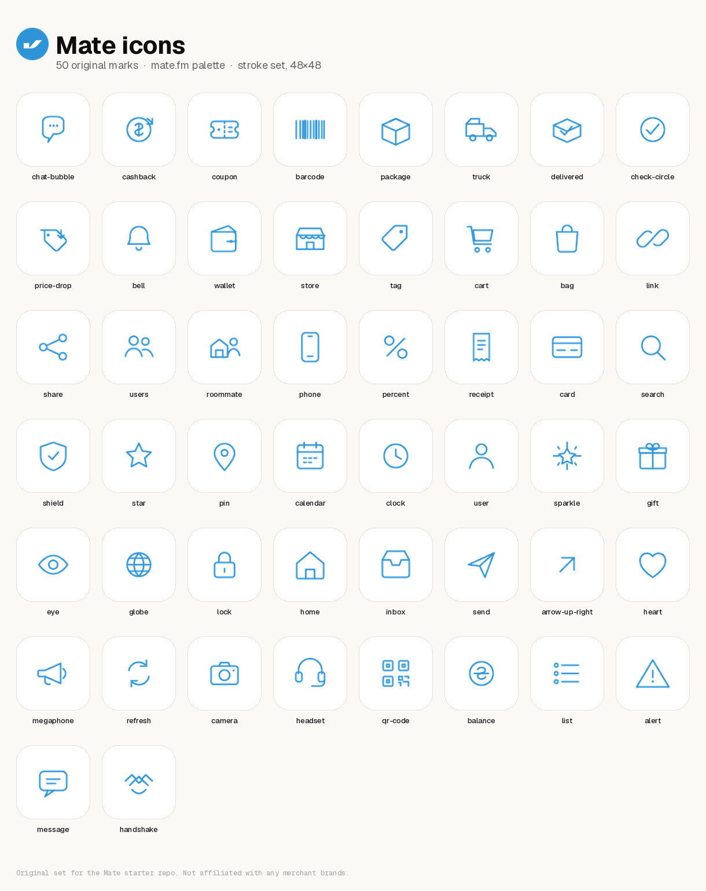

# Mate icons

Original stroke icons drawn for this repository in the [mate.fm](https://mate.fm/) palette.
They are not merchant or third-party brand logos.

**50 icons** · viewBox `48×48` · primary stroke `#2E94D6` · round caps.

## Files

- `svg/` — source marks
- `png/64`, `png/128`, `png/512` — raster exports
- `preview.png` — contact sheet

## Palette

- Blue `#2E94D6` (primary mark, same as the Mate logo)
- Ink `#0D0D0D`
- Soft blue `#CDE7FC`
- Green `#5AA83E` and orange `#F0813C` appear in the product site and may be used as status accents, not in this monochrome set

## Catalog

| File | Meaning |
| --- | --- |
| `chat-bubble` | Chat bubble |
| `cashback` | Cashback |
| `coupon` | Discount code |
| `barcode` | Barcode |
| `package` | Package |
| `truck` | Truck |
| `delivered` | Delivered |
| `check-circle` | Check circle |
| `price-drop` | Price drop |
| `bell` | Alert bell |
| `wallet` | Wallet |
| `store` | Store |
| `tag` | Tag |
| `cart` | Cart |
| `bag` | Shopping bag |
| `link` | Tracked link |
| `share` | Share |
| `users` | Users |
| `roommate` | Room-mate |
| `phone` | Phone |
| `percent` | Percent off |
| `receipt` | Receipt |
| `card` | Card |
| `search` | Search |
| `shield` | Shield |
| `star` | Star |
| `pin` | Map pin |
| `calendar` | Calendar |
| `clock` | Clock |
| `user` | User |
| `sparkle` | Sparkle |
| `gift` | Gift |
| `eye` | Watching |
| `globe` | Globe |
| `lock` | Lock |
| `home` | Home |
| `inbox` | Inbox |
| `send` | Send |
| `arrow-up-right` | Arrow up right |
| `heart` | Heart |
| `megaphone` | Megaphone |
| `refresh` | Refresh |
| `camera` | Camera |
| `headset` | Headset |
| `qr-code` | QR code |
| `balance` | Balance |
| `list` | List |
| `alert` | Alert |
| `message` | Text message |
| `handshake` | Partnership |

Regenerate with `python tools/generate_assets.py` (needs Pillow and cairosvg).
